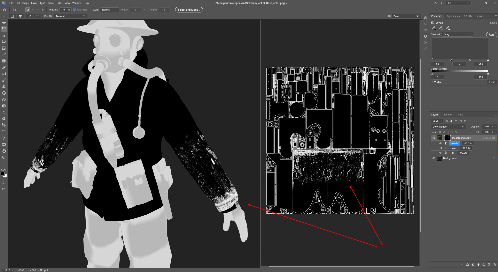
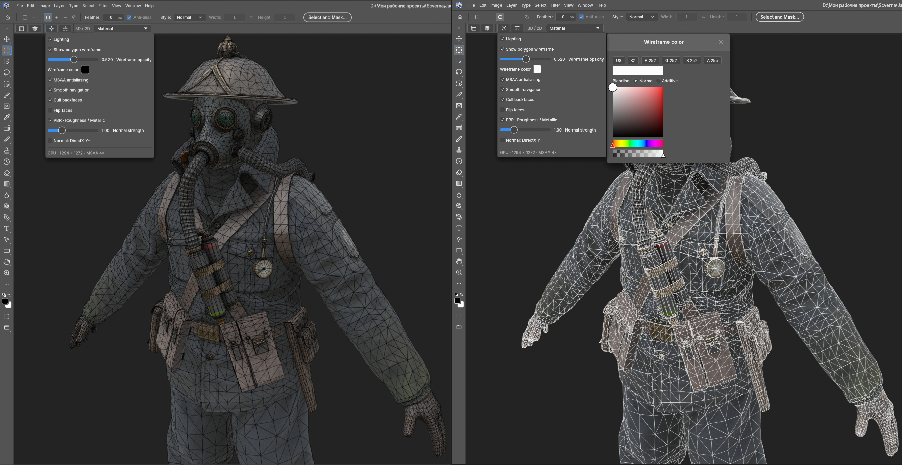
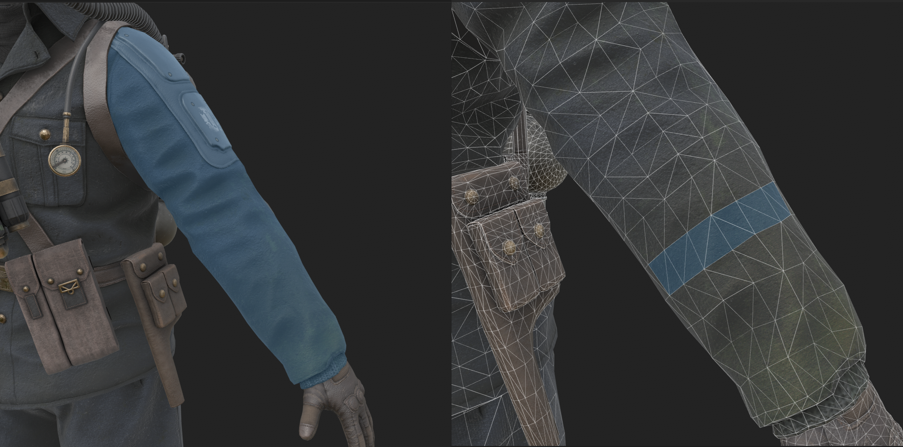

# PhotoCraft 3D / UV workspace

The optional `uv-workbench` feature combines a native 3D model viewport with
PhotoCraft's layered texture editor. This presentation shows the updated
PhotoCraft 0.16.0 build using screenshots supplied by the contributor.

## 1. Overview

View the textured model and its editable 2D UV map side by side. The material
panel exposes texture bindings while the ordinary Layers panel remains available.


## 2. Mask sublayers

An editable mask stack contains Paint, Fill and Levels effects. The screenshot
shows the expanded stack, Levels controls and the grayscale mask on both the
model and the 2D texture. The red annotations belong to the supplied screenshot.
Use `.pcuv` or `.pcraft` to retain the editable stack; flat texture export stores
the rendered result.



## 3. Polygon wireframe

Overlay the imported polygon mesh on the textured model. Wireframe color and
opacity are adjustable; the supplied comparison shows dark and light wireframes.
This is a display overlay and does not modify the model geometry.



## 4. Model selection

Select UV shells or individual polygons on the model. The screenshot shows a
selected sleeve region and a narrower face selection with the wireframe visible.
Polygon selections become the texture document's native selection when switching
tools, so subsequent texture edits can respect that region and support Undo.



## Try the workspace

```sh
cargo run -p photocraft --features uv-workbench
```

Choose the **3D** workspace, then **File > 3D Import > Import Model**.
See [the workspace guide](uv-workbench.md) for supported formats, controls and
limitations. The character model and source textures shown here are not bundled.
Screenshot provenance is recorded [beside the images](images/uv-showcase/README.md).
